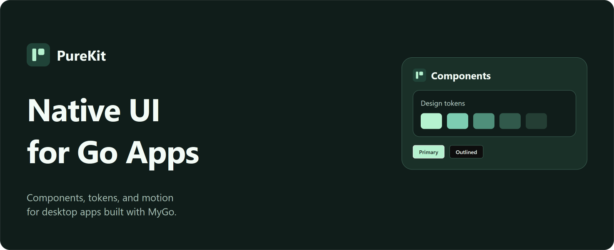

# PureKit

PureKit is a UI kit for native Go apps built with [MyGo](https://github.com/egoist/mygo). It renders components on the GPU and runs interactive examples in the browser through WebAssembly.

[Getting started](./docs/getting-started.mdx) · [Component catalog](./catalog) · [Changelog](./CHANGELOG.md) · [GitHub](https://github.com/puremixlab/purekit)

[](https://github.com/puremixlab/purekit/actions/workflows/quality.yml)
[](https://pkg.go.dev/github.com/puremixlab/purekit)
[](./LICENSE)

## Components

- Over 70 components for actions, inputs, forms, navigation, overlays, and layout.
- System light and dark appearance, with configurable colors, radii, and type sizes.
- Springs and shared-element transitions for controls, popups, and notifications.
- Native desktop builds in pure Go, with Lucide icons and component strings in English and Simplified Chinese.


## Getting started

PureKit requires Go 1.27.3 or later.

```sh
go get github.com/puremixlab/purekit
```

```go
package main

import (
	"fmt"
	"log"

	"github.com/egoist/mygo"
	"github.com/egoist/mygo/ui"
	"github.com/puremixlab/purekit/pkg/action"
	"github.com/puremixlab/purekit/pkg/theme"
)

var count int

func view(c *ui.Context) {
	theme.Apply(c)
	ui.Column(c).Fill().Center().Gap(12).Background(theme.TokensOf(c).BgContainer).Children(func() {
		if action.Button(c, "Hello PureKit", action.ButtonProps{Variant: action.Primary}).Clicked() {
			count++
		}
		ui.Text(c, fmt.Sprintf("Clicked %d times", count))
	})
}

func main() {
	mygo.App.WhenReady(func() {
		mygo.NewWindow(mygo.WindowOptions{Title: "Hello PureKit", Width: 480, Height: 320, Content: ui.View(view)})
	})
	if err := mygo.App.Run(); err != nil {
		log.Fatal(err)
	}
}
```

Call `theme.Apply(c)` at the top of each view and use `theme.TokensOf(c)` for its design tokens. For a full desktop window with a title bar, sidebar, tabs, and settings, see [the desktop starter](./examples/desktop).

## Packages

| Package        | Components                                                                                                                              |
| -------------- | --------------------------------------------------------------------------------------------------------------------------------------- |
| `pkg/action`   | Button, ActionIcon, ActionIconGroup, CopyButton, Segmented                                                                              |
| `pkg/field`    | Input, TextArea, InputNumber, InputPassword, InputOTP, Select, AutoComplete, SearchBar, HotkeyInput, EditableText, DatePicker, Calendar, Upload |
| `pkg/choice`   | Checkbox, RadioGroup, Switch, Slider, Rate, ToggleGroup, ColorSwatches, ColorPicker, ImageSelect                                        |
| `pkg/display`  | Text, Tag, Avatar, GroupAvatar, AgentAvatar, Icon, Hotkey, Image, List, Accordion, Empty, Skeleton                                      |
| `pkg/feedback` | Alert, Badge, Progress, Spin, Result, Modal, Drawer, Toast, FloatingPanel, FloatingSheet                                                |
| `pkg/overlay`  | Tooltip, Popover, DropdownMenu, ContextMenu                                                                                             |
| `pkg/nav`      | Tabs, Pagination, Breadcrumb, Steps, Burger                                                                                             |
| `pkg/layout`   | Block, Grid, Divider, ScrollArea, DraggablePanel, Header, SideNav, DraggableSideNav, Layout, GuideCard, SortableList                    |
| `pkg/form`     | Form, Field, Group, SubmitFooter |
| `pkg/code`     | Highlighter, Snippet, QRCode                                                                                                            |
| `pkg/markdown` | Markdown, with streaming                                                                                                                |
| `pkg/theme`    | Light and dark tokens, sizes, shadows                                                                                                   |
| `pkg/motion`   | Springs, easings, transitions                                                                                                           |
| `pkg/lucide`   | Lucide icons                                                                                                                            |

## Local development

Use Go 1.27.3 or newer and Bun 1.4 or newer.

```sh
git clone https://github.com/puremixlab/purekit.git
cd purekit
go test ./...
go run ./catalog
go run ./examples/desktop
bun install --frozen-lockfile
bun run dev
```

Each component page includes a live demo and a Go API table. Use `bun run build` to generate the static documentation in `dist`. Set `PUREKIT_DOCS_URL` to the public site origin when building for deployment. Local builds use `http://localhost:5173`.

## Attribution and license

PureKit is based on [Lobe MyGo](https://github.com/lobehub/lobe-mygo) by [LobeHub](https://github.com/lobehub). The design tokens are generated from [Lobe UI](https://github.com/lobehub/lobe-ui).

Copyright © 2026 LobeHub. See the [MIT license](./LICENSE) and the [Lucide and Feather icon notices](./pkg/lucide/LICENSE).
